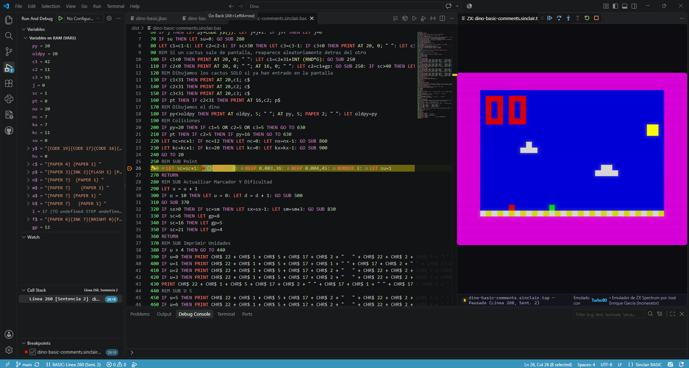

# Sinclair BASIC for Visual Studio Code

<p align="center">
  
</p>

> **Disclaimer**: This is an independent, unofficial community extension providing development tools for the **Sinclair BASIC** programming language on ZX Spectrum and compatible retro computers. It is not affiliated with, sponsored by, or endorsed by Sinclair Research, Amstrad, Sky, or any of their successors.

---

A comprehensive VS Code extension for developing Sinclair ZX Spectrum BASIC applications, supporting both **Standard Sinclair BASIC (`.bas`)** and an **optional modern pseudo-language (`.jbas`)** with labels, line comments, line-number renumbering, automatic `.tap` compilation, integrated emulator, and **interactive step-by-step debugging (DAP)**.

**Universal Extension**: Fully compatible with both **VS Code Desktop** and **VS Code for the Web** ([vscode.dev](https://vscode.dev) & [github.dev](https://github.dev)) with 0 installation requirements.

---

## Features

### 1. Dual Language Support
* **Standard Sinclair BASIC (`.bas`)**:
  * Accurate syntax highlighting for Sinclair BASIC keywords (`PRINT`, `LET`, `DIM`, `POKE`, `PEEK`, etc.).
  * Display attributes highlighting (`INK`, `PAPER`, `FLASH`, `BRIGHT`, `BORDER`, `OVER`, `INVERSE`).
  * ZX Spectrum functions (`CODE`, `CHR$`, `ATTR`, `POINT`, `SCREEN$`, `BIN`, etc.).
  * Standard `REM` comments.
  * Line number awareness and folding for loops and subroutines.

* **Modern Sinclair BASIC Pseudo-Language (`.jbas`) (Optional)**:
  * Develop without managing line numbers manually.
  * Define structured jump targets with labels: `@label:`.
  * Jump cleanly using `GO TO @label`, `GO SUB @label`, `THEN @label`, etc.
  * **Go to Definition (`Ctrl+Click` / `F12`)**: Hover over any `@label` with Ctrl or click to jump straight to its `@label:` definition.
  * **Rename Symbol (`F2`)**: Press `F2` on any label to rename all occurrences and definitions safely across the document.
  * **Find References (`Shift+F12`)**: Inspect every place where `@label` is called.
  * **Outline & Breadcrumbs**: Displays all `@labels` in VS Code's Outline view and Symbol Search (`Ctrl+Shift+O`).
  * **Automatic Indentation**: Writing `@label:` and pressing `Enter` automatically indents the code block inwards.
  * **Duplicate Label Detection**: Flags duplicate label definitions with real-time error diagnostics in the editor and halts compilation with line details.
  * Single-quote inline comments: `' this is a comment` (preserving single quotes inside string literals like `PRINT "DON'T"`).
  * **Inline Control Codes & Maximum Performance Optimization**:
    * **Standard `bas2tap` Escape Sequences**: Full support for inline control sequences inside string literals: `{PAPER n}`, `{INK n}`, `{FLASH n}`, `{BRIGHT n}`, `{INVERSE n}`, `{OVER n}`, `{AT row, col}`, `{TAB x}`, `{CODE n}`, and `\xHH`.
    * **Real-time Color Preview in `LIST`**: In the ZX Spectrum emulator or real hardware, running `LIST` directly executes the color attribute bytes, rendering authentic colored character blocks (e.g. green or magenta squares) inside the quotes in real time.
    * **Constant Expression Folding**: Automatically converts slow runtime `CHR$` concatenations:
      ```basic
      ' Source code in .jbas:
      LET c$ = CHR$ 17 + CHR$ 4 + " " + CHR$ 17 + CHR$ 1 + " "
      ' Automatically folded in optimal dist/<name>.bas:
      LET c$="{PAPER 4} {PAPER 1} "
      ```
      This eliminates runtime string allocations, garbage collection pauses, and floating-point math on the Z80.
    * **PRINT Attribute Inlining**: In `PRINT` statements, automatically absorbs constant screen attributes into the following string literals:
      ```basic
      ' Source:
      PRINT AT 10, 1; "THERE IS NO INTERNET CONNECTION"
      IF py<>oldpy THEN PRINT AT oldpy,5; " "; AT py,5; PAPER 2; " "

      ' Optimal build:
      PRINT "{AT 10,1}THERE IS NO INTERNET CONNECTION"
      IF py<>oldpy THEN PRINT AT oldpy,5; " "; AT py,5; "{PAPER 2} "
      ```
      Bypasses the ROM's expression evaluator loop, saves ~14 bytes of hidden floating-point numbers per `AT`, and dramatically speeds up game frame rates.
    * **ZX Spectrum ROM `0x0D` Guard**: Automatically preserves `AT 13, col` and `AT row, 13` in standard Sinclair BASIC syntax (`PRINT AT 13, 7; "{PAPER 7} "`). This safeguards against injecting byte 13 (`0x0D` / `ENTER`) inside string literals, which would cause the ZX Spectrum ROM parser to prematurely terminate the line and throw error `C Nonsense in BASIC`.
  * Transpiles to clean, standard numbered `.bas` or compiles directly to `.tap`.

### 2. Autocompletion & IntelliSense (`.bas` & `.jbas`)
* **Comprehensive Sinclair BASIC Keywords**: Instant completion for all Sinclair ZX Spectrum BASIC statements (`PRINT`, `LET`, `IF`, `FOR`, `NEXT`, `GO TO`, `POKE`, etc.), functions (`PEEK`, `CHR$`, `CODE`, `INKEY$`, `SCREEN$`, `ATTR`, `POINT`, `RND`, `BIN`, `USR`, etc.), and display attributes (`BORDER`, `PAPER`, `INK`, `FLASH`, `BRIGHT`, `INVERSE`, `OVER`).
* **Rich Documentation & Syntax Previews**: Each keyword item includes syntax reference and detailed markdown explanation.
* **Smart Snippet Templates**: Expand common structures like `FOR...TO...NEXT`, `IF...THEN`, `DEF FN`, and `PRINT AT` with interactive tab stops.
* **Control Code Completion**: Typing inside `{` in string literals suggests `bas2tap` control codes (`INK`, `PAPER`, `FLASH`, `BRIGHT`, `INVERSE`, `OVER`, `AT`, `TAB`, `CODE`).
* **Label Completion in `.jbas`**: Typing `@` automatically suggests jump labels defined across the current document.

### 3. Uppercase Keyword Formatter (`Shift+Alt+F`)
* **Standard VS Code Formatting**: Formats full document or selection with `Shift+Alt+F`, right-click "Format Document", or on save via `editor.formatOnSave`.
* **Converts All Keywords to UPPERCASE**: Ensures authentic Sinclair BASIC appearance and style.
* **Zero False Positives**:
  * Text inside double quotes (`"..."`) is 100% strictly preserved.
  * `REM` comments and JBAS single-quote comments (`' ...`) are 100% strictly preserved.
  * JBAS `@labels` are strictly preserved.
  * Variables containing keyword substrings (e.g. `score`, `total`, `stopwatch`, `point1`) are never touched.

### 4. Intelligent Line Renumbering (`.bas`)
* Renumbers program lines starting at line 10 with step 10 (or user-configured values).
* Automatically updates all jump and line references:
  * `GO TO` / `GOTO`
  * `GO SUB` / `GOSUB`
  * `RESTORE`
  * `RUN`
  * `LINE`
  * `THEN <line>`
  * Multi-target computed jumps: `ON x GO TO 10, 20, 30`
* **Zero false positives**: Strings (`PRINT "GOTO 10"`) and `REM` comments are completely untouched.

### 5. Subroutine Code Folding (`.bas`)
* **Semantic Subroutine Folding**: Detects function calls using `GO SUB <line>` or `GOSUB <line>` (as well as computed multi-targets like `ON x GOSUB 100, 200`).
* Folds the subroutine body starting at its target definition line and ending at its corresponding `RETURN` statement.
* Fully protects against false positives in string literals and `REM` comments.
* Notice: `.jbas` files use modular `@labels` without line numbers and preserve their own standard structural folding.

### 6. Jump Target Navigation / Go to Definition (`Ctrl+Click` / `F12`)
* **Interactive Navigation in `.bas`**: Hold `Ctrl` (or `Cmd` on macOS) and click on any target line number following `GO SUB`, `GOSUB`, `GO TO`, `GOTO`, `RUN`, `RESTORE`, or computed jumps (`ON x GO SUB 100, 200`) to jump directly to that line definition in the code.
* **Interactive Navigation in `.jbas`**: Ctrl+Click on `@label` jumps directly to `@label:`.
* **Zero False Positives**: Does not trigger on coordinates (`PRINT AT 10, 20`), variable assignments, string literals (`"GO SUB 500"`), or comments (`REM GO SUB 500`).

### 7. Interactive BASIC Debugger (Native VS Code DAP + Turbo80)
* **Native VS Code Debugging Experience (DAP)**: Full step-by-step debugger integrated with VS Code's native floating debug toolbar, **Variables** inspector, and **Call Stack** panels.
* **Full Speed with Zero Overhead**: Intercepts the ZX Spectrum 48K ROM statement dispatcher (`0x1B3D`) via native Turbo80 breakpoint conditions (`bpConds`), running at full 50 FPS emulation speed without throttling until a breakpoint or step is hit.
* **Control with Native VS Code Shortcuts**:
  * **`F5`**: Start / Continue execution.
  * **`F6`**: Pause execution at current statement.
  * **`F10`**: Step Over (Line-by-line step).
  * **`F11`**: Step Into (Statement-by-statement step, traversing multi-statement lines `LET a=1: LET b=2`).
  * **`Ctrl+Shift+F5`**: Restart debugging session.
  * **`Shift+F5`**: Stop debugging and close emulator.
* **Statement-Level Inline Breakpoints (`Shift+F9`)**: Set breakpoints on individual statements within the same line, clicking internal glyphs or using `Shift+F9`. Turbo80 tracks both the line (`PPC` `0x5C45`) and statement index (`SUBPPC` `0x5C47`).
* **Live RAM Variable Inspection**: Decodes the Sinclair BASIC RAM variable table in real time:
  * Numbers (5-byte Sinclair floating-point format).
  * Text strings (with byte-by-byte length and character code inspection).
  * `FOR` loop control variables (current value, limit, step, loop line).
* **Transparent Source Mapping (`.jbas` <-> `.bas`)**: Place breakpoints directly in `.jbas` source files. Line mapping automatically translates breakpoints to compiled `.bas` TAP lines, scanning forward through comments and whitespace, and pauses on the exact statement in the active `.jbas` file.
* **Clean Retro Display**: The emulator screen remains 100% clean and authentic without cluttered UI buttons, letting VS Code handle all debug controls.

### 8. Integrated Toolchain, Emulation & Instant Sharing
* **Built-in Pure JavaScript TAP Generator**: Blazing fast, zero external dependencies (no `bas2tap` executable required). Automatically encodes Sinclair BASIC keywords, Spectrum floating-point numbers, UDGs, and headers with autostart line. Full byte-for-byte parity with `bas2tap` whitespace rules, avoiding unwanted double spaces when programs are listed by the ZX Spectrum ROM (e.g., `LET py=0`, `CHR$ 18`). An optional fallback to external `bas2tap` is available via settings.
* **Built-in Web Emulator (Turbo80)**: Instant execution inside a VS Code tab with zero external installs. Features authentic audio, CRT shader effects, 48K/128K model selection, and on-screen keyboard support.
* **Instant Web Sharing via Turbo80.com**: Generate a public, shareable link with one click (`Sinclair BASIC: Share on Turbo80.com`). Compiles your `.bas` or `.jbas` to `.tap` (or takes any existing `.tap`), uploads it, copies the `https://turbo80.com/?load=...` link directly to your clipboard, and lets your friends and colleagues test your game immediately in any browser with zero setup.
* **External Desktop Emulator Support**: One-click build and launch in external emulators (e.g. Fuse, CSpect, Retro Virtual Machine) if preferred.

### 9. Import Sinclair BASIC & JBAS from TAP Files
* **One-Click TAP Import**: Right-click any `.tap` file in the Explorer (or run `Sinclair BASIC: Import BAS and JBAS from TAP` from the Command Palette) to instantly extract the Sinclair BASIC program stored on the tape.
* **Dual Output Formats**:
  * **Standard Sinclair BASIC (`.bas`)**: Full numbered source code reconstructing all statements, functions, operators, and screen attributes.
  * **Modern Pseudo-Language (`.jbas`)**: Converts jump targets (`GO TO`, `GO SUB`, `THEN`, `RESTORE`, etc.) to clean `@labels`, converts `REM` to modern `'` single-quote comments, removes line numbers, and automatically indents routine bodies.
* **Full Encoding & Control Code Fidelity**: Automatically detokenizes Sinclair BASIC tokens, decodes hidden floating-point numbers (including protected loader lines), UDGs (`{A}`..`{U}`), control codes (`{PAPER n}`, `{INK n}`, `{AT row, col}`, `{TAB x}`, `{CODE n}`), and special characters (`{(c)}`, `£`).
* **Instant Editor Opening**: Opens the extracted code directly in the VS Code editor with full syntax highlighting, navigation, and debugging support.

### 10. Authentic ZX Spectrum +3 BASIC Retro Mode
* **One-Click Retro Mode Toggle**: Click the `$(sparkle) ZX Retro: ON/OFF` status bar item or run `Sinclair BASIC: Toggle Retro Mode`.
* **Authentic +3 BASIC 3-Sound Audio Engine**:
  * **Line Confirmation Tone on Enter** (`media/sound/zx_click.wav`): When you submit a syntactically valid line of BASIC, emits the authentic positive line acceptance tone (105 ms) and automatically formats keywords to UPPERCASE.
  * **Syntax Error Buzz on Enter** (`media/sound/zx_error.wav`): If the line has a syntax error (e.g. unclosed quotes, invalid statements, missing line numbers in `.bas`), emits the authentic ZX Spectrum warning/error rasp buzz (255 ms).
  * **Cursor Navigation Click** (`media/sound/zx_cursor.wav`): Emits the subtle mechanical keyboard tick (22 ms) when navigating lines or moving the cursor with arrow keys (throttled to 55 ms to match genuine key-repeat cadence).
  * **Zero Latency**: Sounds are pre-loaded in memory via a persistent background audio engine.
* **Auto-Uppercase Formatting on Enter**: When you press `Enter` on a valid line, all Sinclair BASIC keywords are instantly formatted to **UPPERCASE** (`print "hello" -> PRINT "hello"`), strictly preserving string literals (`"..."`) and comments (`REM`, `'`).
* **+3 BASIC Line Number Substitution**: When you enter a numbered BASIC line (`.bas`) whose line number already exists in the document and press `Enter`, it automatically replaces the existing line with the new formatted content and cleans up the input line, emulating the ZX Spectrum +3 BASIC statement entry. Typing only a line number (e.g. `10` + `Enter`) deletes that line from the program.
* **Clean Retro Display (Zero Distractions)**: Automatically applies authentic ZX Spectrum +3 Paper 7 / Border 7 (`#D9D9D9`) background and blue block cursor (`#2A2AF0`), sets the bold 8x8 ZX Spectrum font, displays the `+3 BASIC` bottom bar with the 4 diagonal Spectrum stripes, closes the bottom panel, and hides tabs, breadcrumbs, minimap, and line numbers margin for true ZX Spectrum immersion.
* **100% Reversible Switch**: Toggling off (even after restarting VS Code) instantly restores the user's original theme, tabs, breadcrumbs, colors, font, minimap, line numbers, and single-group editor layout.

---

## Commands & Shortcuts

All commands are accessible from the Command Palette (`Ctrl+Shift+P` / `Cmd+Shift+P`), the editor toolbar (top-right buttons), editor context menu, and Explorer file context menu:

| Command | Identifier | Shortcut | Description |
|---|---|---|---|
| **Debug in Web Emulator (Turbo80)** | `sinclairBasic.debugTurbo80` | `F5` | Starts interactive step-by-step debugging in Turbo80 with native VS Code debug bar and variable inspection. |
| **Compile JBAS to TAP** | `sinclairBasic.compileJBas` | `Ctrl+Shift+B` | Generates `.bas` versions in `dist/` (including `<name>.sinclair.bas` translating `bas2tap` wildcards to standard `CHR$`) and builds `.tap` from the optimal 1x1 version. |
| **Transpile JBAS to BAS** | `sinclairBasic.transpileJBas` | `Ctrl+Shift+T` | Generates 4 versions in `dist/` (`<name>.bas` 1x1, `<name>-step10.bas`, `<name>-comments.bas`, and `<name>.sinclair.bas` with standard `CHR$`) and opens `step10` in editor. |
| **Compile BAS to TAP** | `sinclairBasic.compileBas` / `buildTap` | `Ctrl+Shift+B` | Compiles `.bas` directly to `.tap` and generates `dist/<name>.sinclair.bas` translating `bas2tap` wildcards to standard `CHR$`. |
| **Import BAS and JBAS from TAP** | `sinclairBasic.importTap` | — | Decodes a `.tap` file and extracts both standard `.bas` and modern `.jbas` versions. |
| **Import BAS from TAP** | `sinclairBasic.importTapToBas` | — | Extracts standard numbered `.bas` from a `.tap` file. |
| **Import JBAS from TAP** | `sinclairBasic.importTapToJBas` | — | Extracts modern `.jbas` (with `@labels` and `'` comments) from a `.tap` file. |
| **Share on Turbo80.com** | `sinclairBasic.shareTurbo80` | — | Compiles/locates `.tap`, uploads it, and copies a ready-to-play `https://turbo80.com/?load=...` link to clipboard. |
| **Format Keywords to Uppercase** | `sinclairBasic.formatKeywords` | `Shift+Alt+F` | Formats document or selection converting all Sinclair BASIC keywords to uppercase (preserving strings and comments). |
| **Renumber BAS Lines (.bas)** | `sinclairBasic.renumber` / `renumberBas` | `Ctrl+Alt+R` | Renumbers lines in `.bas` (10 by 10) and updates all jump references (`GOTO`, `GOSUB`, `RESTORE`, etc.). |
| **Run in Emulator** | `sinclairBasic.runEmulator` | `Ctrl+F5` | Compiles to TAP and launches the configured emulator (built-in Turbo80 Webview or external Fuse). |
| **Run in Web Emulator (Turbo80)** | `sinclairBasic.runTurbo80` | — | Forces execution in the built-in Turbo80 web emulator tab. |
| **Run in External Emulator** | `sinclairBasic.runExternalEmulator` | — | Forces execution in the configured external desktop emulator. |
| **Toggle Retro Mode** | `sinclairBasic.toggleRetroMode` | — | Toggles authentic +3 BASIC retro mode (paper 7 white canvas, ZX 8x8 font, line audio feedback). |

---


## Configuration Settings

You can customize the extension via VS Code Settings (`settings.json`):

```json
{
  "sinclairBasic.retroMode.enabled": false,
  "sinclairBasic.retroMode.beepOnEnter": true,
  "sinclairBasic.retroMode.beepOnError": true,
  "sinclairBasic.retroMode.beepOnCursor": true,
  "sinclairBasic.retroMode.formatOnEnter": true,
  "sinclairBasic.retroMode.replaceExistingLine": true,
  "sinclairBasic.replaceExistingLineNumber": false,
  "sinclairBasic.emulatorType": "turbo80",
  "sinclairBasic.turbo80Model": "48k",
  "sinclairBasic.turbo80Crt": true,
  "sinclairBasic.emulatorPath": "C:\\Program Files (x86)\\Fuse\\fuse.exe",
  "sinclairBasic.emulatorArgs": [],
  "sinclairBasic.outputDirectory": "dist",
  "sinclairBasic.autoStartLine": 0,
  "sinclairBasic.renumberStart": 10,
  "sinclairBasic.renumberStep": 10,
  "sinclairBasic.optimizePrintAttributes": true
}
```

* `sinclairBasic.retroMode.enabled`: Enables authentic ZX Spectrum retro experience with keyclick sound on Enter and auto-formatting.
* `sinclairBasic.retroMode.beepOnEnter`: Emits authentic Sinclair ZX Spectrum 48K ROM keyclick tone (~987 Hz square wave) upon pressing Enter.
* `sinclairBasic.retroMode.formatOnEnter`: Automatically formats Sinclair BASIC keywords to UPPERCASE upon pressing Enter on a line.
* `sinclairBasic.optimizePrintAttributes`: Enabled by default (`true`). Automatically folds constant `PRINT` attributes (`AT`, `PAPER`, `INK`, `FLASH`, `BRIGHT`, etc.) into compact control code strings for peak ZX Spectrum execution speed while letting developers write standard, natural Sinclair BASIC in `.jbas`.
* `sinclairBasic.emulatorType`: Set to `"turbo80"` (default, opens embedded web emulator) or `"external"` (launches Fuse or desktop emulator).
* `sinclairBasic.turbo80Model`: Emulated ZX Spectrum machine (`48k`, `128k`, `plus2`, `plus2a`, `plus3`, `16k`).
* `sinclairBasic.turbo80Crt`: Enables/disables authentic CRT television shader filter.
* `sinclairBasic.autoStartLine`: When set to `0`, the extension automatically detects the first line number in the BASIC file.

---

## Acknowledgements & Credits

* **Turbo80 (Built-in Offline ZX Spectrum Emulator)**: Powered by [Turbo80](https://turbo80.com) created by **José Enrique García (Incinerator)**. Bundled locally for 100% offline emulation without requiring an active internet connection.
* **ROMs & Legal Notice**:
  * **Amstrad**: Copyright holder of the Sinclair ZX Spectrum (16K, 48K, Spectrum+, 128K) and Amstrad (+2, +2A, +3) ROMs (© 1982-1987 Sinclair Research Ltd / Amstrad), with permission kindly granted for redistribution with emulators (*"Amstrad have kindly given their permission for the redistribution of their copyrighted material but retain that copyright"*).
  * **Timex**: TC2048, TC2068, and TS2068 ROM modifications are in the public domain.
  * **Interface 1**: ROM is © 1983 Sinclair Research Ltd.
  * **esxDOS**: esxDOS 0.8.9 (© 2005-2021 Papaya Dezign, Miguel Guerreiro, https://esxdos.org/) included with permission.
  * **+D and DISCiPLE**: ROMs included with permission from Datel.
  * **ZXDB**: Software metadata powered by [ZXDB](https://github.com/zxdb/ZXDB) (Einar Saukas and contributors, ODbL 1.0) and World of Spectrum.

---

## Development & Debugging

1. Clone and open this repository in Visual Studio Code:
   ```bash
   git clone https://github.com/rtorralba/vscode-sinclair-basic.git
   cd vscode-sinclair-basic
   code .
   ```
2. Press **`F5`** (or go to *Run and Debug* -> *Run Sinclair BASIC Extension*).
3. A new Extension Development Host window will open.
4. Open any `.bas` or `.jbas` file (such as in your game project) and test syntax highlighting, commands, and shortcuts!

### Running Automated Tests
Run the standalone Node test runner (zero external dependencies required):
```bash
npm test
```

---

## License & Copyright

GNU Affero General Public License v3.0 (AGPL-3.0).  
Copyright (C) 2026 **Raül Torralba**.

> **Renuncia de garantía / Disclaimer (AS IS)**: El software se proporciona "tal cual" (*AS IS*), sin garantía de ningún tipo, expresa o implícita. En ningún caso el autor será responsable de ningún reclamo, daño u otra responsabilidad derivada del uso de este software.

See the full [LICENSE](LICENSE) file for complete details.

### Acknowledgements & Special Attribution / Mención Especial
* **Turbo80**: Built-in 100% offline ZX Spectrum web emulation and instant game sharing powered by [Turbo80](https://turbo80.com), created by **José Enrique García (Incinerator)**. Special thanks and attribution for his outstanding contribution to the retrocomputing community.
* **Amstrad & Hardware Rights Holders**: Warm appreciation to Amstrad, Datel, and Papaya Dezign for permitting the inclusion of original ROMs in retrocomputing emulators.
