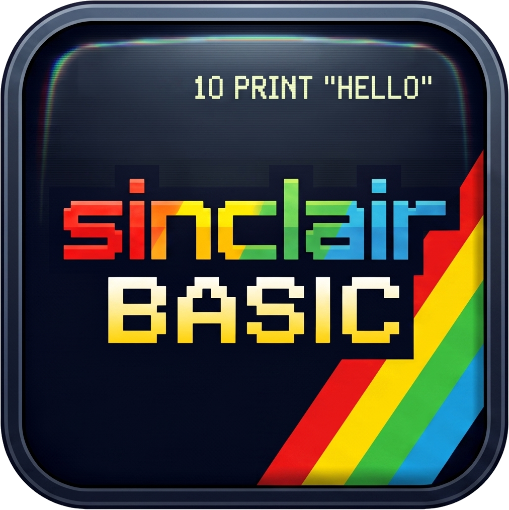

# Sinclair BASIC for Visual Studio Code (Unofficial)

<p align="center">
  
</p>

> **Disclaimer**: This is an independent, unofficial community extension providing development tools for the **Sinclair BASIC** programming language on ZX Spectrum and compatible retro computers. It is not affiliated with, sponsored by, or endorsed by Sinclair Research, Amstrad, Sky, or any of their successors.

---

A comprehensive VS Code extension for developing Sinclair ZX Spectrum BASIC applications, supporting both **Standard Sinclair BASIC (`.bas`)** and an **optional modern pseudo-language (`.jbas`)** with labels, line comments, line-number renumbering, automatic `.tap` compilation, and integrated emulator.

**Universal Extension**: Fully compatible with both **VS Code Desktop** and **VS Code for the Web** ([vscode.dev](https://vscode.dev) & [github.dev](https://github.dev)) with 0 installation requirements.

---

## Features

### 1. Dual Language Support
* **Standard Sinclair BASIC (`.bas`)**:
  * Accurate syntax highlighting for Sinclair BASIC keywords (`PRINT`, `LET`, `DIM`, `POKE`, `PEEK`, etc.).
  * Display attributes highlighting (`INK`, `PAPER`, `FLASH`, `BRIGHT`, `BORDER`, `OVER`, `INVERSE`).
  * ZX Spectrum functions (`CODE`, `CHR$`, `ATTR`, `POINT`, `SCREEN$`, `BIN`, etc.).
  * Standard `REM` comments.
  * Line number awareness and folding for loops and subroutines.

* **Modern Sinclair BASIC Pseudo-Language (`.jbas`) (Optional)**:
  * Develop without managing line numbers manually.
  * Define structured jump targets with labels: `@label:`.
  * Jump cleanly using `GO TO @label`, `GO SUB @label`, `THEN @label`, etc.
  * **Go to Definition (`Ctrl+Click` / `F12`)**: Hover over any `@label` with Ctrl or click to jump straight to its `@label:` definition.
  * **Rename Symbol (`F2`)**: Press `F2` on any label to rename all occurrences and definitions safely across the document.
  * **Find References (`Shift+F12`)**: Inspect every place where `@label` is called.
  * **Outline & Breadcrumbs**: Displays all `@labels` in VS Code's Outline view and Symbol Search (`Ctrl+Shift+O`).
  * **Automatic Indentation**: Writing `@label:` and pressing `Enter` automatically indents the code block inwards.
  * **Duplicate Label Detection**: Flags duplicate label definitions with real-time error diagnostics in the editor and halts compilation with line details.
  * Single-quote inline comments: `' this is a comment` (preserving single quotes inside string literals like `PRINT "DON'T"`).
  * **Optimized Whitespace Compaction**: Automatically strips redundant whitespace around operators (`=`, `+`, `-`, `*`, `/`, `^`, `<`, `>`, `<=`, `>=`, `<>`, `(`, `)`, `,`, `;`, `:`) in the compact version (`dist/<name>.bas`) to minimize RAM consumption and TAP file size, while preserving readable spacing in `dist/<name>-step10.bas`.
  * Transpiles to clean, standard numbered `.bas` or compiles directly to `.tap`.

### 2. Intelligent Line Renumbering (`.bas`)
* Renumbers program lines starting at line 10 with step 10 (or user-configured values).
* Automatically updates all jump and line references:
  * `GO TO` / `GOTO`
  * `GO SUB` / `GOSUB`
  * `RESTORE`
  * `RUN`
  * `LINE`
  * `THEN <line>`
  * Multi-target computed jumps: `ON x GO TO 10, 20, 30`
* **Zero false positives**: Strings (`PRINT "GOTO 10"`) and `REM` comments are completely untouched.

### 3. Integrated Toolchain & Emulation
* **Built-in Pure JavaScript TAP Generator**: Blazing fast, zero external dependencies (no `bas2tap` executable required). Automatically encodes Sinclair BASIC keywords, Spectrum floating-point numbers, UDGs, and headers with autostart line. Full byte-for-byte parity with `bas2tap` whitespace rules, avoiding unwanted double spaces when programs are listed by the ZX Spectrum ROM (e.g., `LET py=0`, `CHR$ 18`). An optional fallback to external `bas2tap` is available via settings.
* **Built-in Web Emulator (Turbo80)**: Instant execution inside a VS Code tab with zero external installs. Features authentic audio, CRT shader effects, 48K/128K model selection, and on-screen keyboard support.
* **External Desktop Emulator Support**: One-click build and launch in external emulators (e.g. Fuse, CSpect, Retro Virtual Machine) if preferred.

---

## Commands & Shortcuts

All commands are accessible from the Command Palette (`Ctrl+Shift+P` / `Cmd+Shift+P`), the editor toolbar (top-right buttons), editor context menu, and Explorer file context menu:

| Command | Identifier | Shortcut | Description |
|---|---|---|---|
| **Compile JBAS to TAP** | `sinclairBasic.compileJBas` | `Ctrl+Shift+B` | Generates 3 `.bas` versions in `dist/` and builds `.tap` strictly from the optimal 1x1 no-comments version (`<name>.bas`). |
| **Transpile JBAS to BAS** | `sinclairBasic.transpileJBas` | `Ctrl+Shift+T` | Generates 3 versions in `dist/` (`<name>.bas` 1x1, `<name>-step10.bas` 10x10, `<name>-comments.bas` 10x10+REM) and opens `step10` in editor. |
| **Compile BAS to TAP** | `sinclairBasic.compileBas` / `buildTap` | `Ctrl+Shift+B` | Compiles `.bas` to a ZX Spectrum `.tap` tape image using native pure JS engine. |
| **Renumber BAS Lines (.bas)** | `sinclairBasic.renumber` / `renumberBas` | `Ctrl+Alt+R` | Renumbers lines in `.bas` (10 by 10) and updates all jump references (`GOTO`, `GOSUB`, `RESTORE`, etc.). |
| **Run in Emulator** | `sinclairBasic.runEmulator` | `Ctrl+F5` | Compiles to TAP and launches the configured emulator (built-in Turbo80 Webview or external Fuse). |
| **Run in Web Emulator (Turbo80)** | `sinclairBasic.runTurbo80` | — | Forces execution in the built-in Turbo80 web emulator tab. |
| **Run in External Emulator** | `sinclairBasic.runExternalEmulator` | — | Forces execution in the configured external desktop emulator. |

---


## Configuration Settings

You can customize the extension via VS Code Settings (`settings.json`):

```json
{
  "sinclairBasic.emulatorType": "turbo80",
  "sinclairBasic.turbo80Model": "48k",
  "sinclairBasic.turbo80Crt": true,
  "sinclairBasic.emulatorPath": "C:\\Program Files (x86)\\Fuse\\fuse.exe",
  "sinclairBasic.emulatorArgs": [],
  "sinclairBasic.outputDirectory": "dist",
  "sinclairBasic.autoStartLine": 0,
  "sinclairBasic.renumberStart": 10,
  "sinclairBasic.renumberStep": 10
}
```

* `sinclairBasic.emulatorType`: Set to `"turbo80"` (default, opens embedded web emulator) or `"external"` (launches Fuse or desktop emulator).
* `sinclairBasic.turbo80Model`: Emulated ZX Spectrum machine (`48k`, `128k`, `plus2`, `plus2a`, `plus3`, `16k`).
* `sinclairBasic.turbo80Crt`: Enables/disables authentic CRT television shader filter.
* `sinclairBasic.autoStartLine`: When set to `0`, the extension automatically detects the first line number in the BASIC file.

---

## Acknowledgements & Credits

* **Turbo80**: The built-in web emulator is powered by [Turbo80](https://turbo80.com) created by José Enrique García (Incinerator). We are deeply grateful for this wonderful web-based ZX Spectrum emulator.

---

## Development & Debugging

1. Clone and open this repository in Visual Studio Code:
   ```bash
   git clone https://github.com/rtorralba/vscode-sinclair-basic.git
   cd vscode-sinclair-basic
   code .
   ```
2. Press **`F5`** (or go to *Run and Debug* -> *Run Sinclair BASIC Extension*).
3. A new Extension Development Host window will open.
4. Open any `.bas` or `.jbas` file (such as in your game project) and test syntax highlighting, commands, and shortcuts!

### Running Automated Tests
Run the standalone Node test runner (zero external dependencies required):
```bash
npm test
```

---

## License
MIT License.
